# NovaShop AI Customer Support Assistant

Repository: `ai-customer-support-assistant`.

A policy-grounded customer support demo built with FastAPI, Gemini, and persistent ChromaDB. It retrieves relevant excerpts from NovaShop's refund and shipping policies, asks Gemini to answer from those excerpts, and returns source citations. If a question is outside the policy topics represented in the current corpus, the service responds with **Insufficient Context** rather than guessing.

This is a portfolio/demo application, not a production customer-support service.

## Features

- Section-aware ingestion of the policy text files in `data/documents/`.
- Gemini `gemini-embedding-001` document and query embeddings, with `RETRIEVAL_DOCUMENT` and `RETRIEVAL_QUERY` task types respectively.
- Persistent ChromaDB collection `novashop_policies`, stored in `data/chroma_db/` and configured to use cosine distance.
- Section/topic-aware reranking that uses policy section metadata alongside vector distance.
- Grounded answer generation with Gemini `gemini-3.5-flash-lite`; retrieved excerpts are treated as data, not instructions.
- FastAPI JSON API and responsive browser dashboard with source and section citations.
- Explicit insufficient-context handling for unrecognized policy topics.

## Prerequisites

- Windows PowerShell (commands below use PowerShell syntax).
- Python 3.10.4 (pinned by `.python-version`; this exact version is used by the project virtual environment).
- A Gemini API key with access to the configured embedding and generation models, plus network access to the Gemini API.

## Configuration and installation

From the project directory:

```powershell
Set-Location "D:\Python Files\AI-Customer-Support-Assistant"
```

Create and activate an environment if you do not already have one:

```powershell
py -3.10 -m venv .venv
.\.venv\Scripts\Activate.ps1
python -m pip install --upgrade pip
python -m pip install -r requirements.txt
```

Copy the checked-in template to a local, ignored `.env` file and edit it locally:

```powershell
Copy-Item .env.example .env
notepad .env
```

The app reads `GEMINI_API_KEY` and optional `CHROMA_DIR` from process environment variables and the project-local `.env`. For compatibility with an earlier local setup, it also checks `D:\Python Files\.env` after the project-local file. Existing process environment variables take precedence. `CHROMA_DIR` defaults to `./data/chroma_db`; relative values resolve from the project root, and absolute paths are accepted (for example, a Render persistent-disk mount).

The checked-in `.env.example` contains placeholders only. Never paste a real API key into source code or this README. `.env` and `.env.*` are ignored, while `.env.example` is explicitly allowed. The legacy parent `.env` is outside the project's ignore rules; prefer the project-local `.env` or a process environment variable.

To set the key for only the current PowerShell session instead of using `.env`:

```powershell
$env:GEMINI_API_KEY = "your_key_here"
```

## Index policy documents

The source documents are `data/documents/refund_policy.txt` and `data/documents/shipping_policy.txt`. Ingestion keeps numbered policy headings with their section text and records source filename, section heading, chunk index, and stable ID. Run this from the project root after adding or changing policy documents:

```powershell
python -c "from app.config import DOCUMENTS_DIR; from app.ingestion import load_documents; from app.vector_store import index_documents; chunks = load_documents(DOCUMENTS_DIR); print(index_documents(chunks))"
```

The index is persisted under `data/chroma_db/`. Indexing uses upsert semantics and stable chunk IDs, so rerunning the command updates existing IDs instead of duplicating them. The database is local runtime data and is excluded by `.gitignore`. Do not delete it unless you intend to rebuild the index; a rebuild calls Gemini for document embeddings. At startup, `app.startup` initializes a missing or empty collection, validates a populated collection's cosine configuration, sample policy metadata, and 3072-dimensional embeddings, and reuses a valid index without embedding it again. A populated but invalid index fails startup with a diagnostic error rather than being silently accepted.

## Render deployment

`render.yaml` defines a Python web service using `.python-version`, installs the pinned dependencies with `python -m pip`, initializes or validates the index before starting Uvicorn, listens on Render's `0.0.0.0:$PORT`, and checks `/api/health`. `GEMINI_API_KEY` is declared with `sync: false`; enter its value privately in the Render dashboard during initial Blueprint creation, or add it in the service's Environment page. Do not put the real value in `render.yaml` or GitHub. `CHROMA_DIR` defaults to `./data/chroma_db` and can be changed in the Render Environment page.

The Blueprint explicitly selects Render's Free plan for a demo. Free web services have an ephemeral filesystem and cannot attach persistent disks. Consequently, this service can rebuild the index from `data/documents/` when the collection is missing or empty, but the Gemini document embeddings will be generated again after a deploy, restart, or free-service spin-down clears the filesystem. This adds startup time and Gemini API usage. For a persistent index, use a paid web-service plan, attach a disk mounted at `/var/data`, and set `CHROMA_DIR=/var/data/chroma_db` privately in the service environment. Render disks are single-instance and prevent zero-downtime deploys; plan and cost details are controlled by Render and may change.

To deploy after publication, create a new Render Blueprint from the GitHub repository and follow the prompt for the private `GEMINI_API_KEY`. Confirm the service health check passes at `/api/health`, then open its `onrender.com` URL.

## Run the website locally

From the project root, with the environment configured:

```powershell
python -m uvicorn app.main:app --reload --host 127.0.0.1 --port 8000
```

Open [http://127.0.0.1:8000](http://127.0.0.1:8000). Keep the server terminal open while using the app. If the port is occupied, identify the owner before stopping it, or choose another port and use that port in the browser URL.

The root route serves `static/index.html`; `/static/styles.css` and `/static/app.js` are served from the same `static/` directory. The browser posts questions to `/api/chat`; the Gemini key remains on the server.

## API usage

### Health check

```powershell
Invoke-RestMethod -Uri "http://127.0.0.1:8000/api/health"
```

### Submit a question

```powershell
$body = @{ question = "How many days do I have to return an order?" } | ConvertTo-Json
Invoke-RestMethod -Uri "http://127.0.0.1:8000/api/chat" -Method Post -ContentType "application/json" -Body $body
```

The request accepts a non-empty `question` of up to 1000 characters. A successful response has this shape:

```json
{
  "answer": "You have 7 calendar days from receiving your order to request a return.",
  "status": "answered",
  "sources": [
    {
      "source": "refund_policy.txt",
      "section": "1. Return Window",
      "chunk_index": 0,
      "id": "refund_policy-0",
      "distance": 0.2615
    }
  ],
  "coverage": {
    "status": "recognized_policy_topic",
    "topics": ["returns"]
  }
}
```

The distance above is an example from a live run, not a fixed expected value. An unsupported or insufficiently evidenced question returns `status: "insufficient_context"` and an explanatory answer; it does not assert facts absent from the policies. Invalid requests are rejected by FastAPI validation. Provider/storage failures return a generic 503 response while server-side logs retain diagnostic details.

## Architecture

```mermaid
flowchart LR
  subgraph Offline[Policy indexing]
    Docs[Refund and shipping policy files] --> Ingest[Load, normalize, section-aware chunking]
    Ingest --> Meta[Stable IDs and source/section/chunk metadata]
    Meta --> DocEmbed[Gemini embedding<br/>RETRIEVAL_DOCUMENT]
    DocEmbed --> Chroma[(Persistent ChromaDB<br/>novashop_policies<br/>cosine distance)]
  end

  subgraph Online[Question answering]
    Browser[Web UI<br/>static HTML/CSS/JS] -->|POST /api/chat| API[FastAPI]
    API --> Service[Support service and topic coverage check]
    Service -->|Known policy topic| QueryEmbed[Gemini embedding<br/>RETRIEVAL_QUERY]
    QueryEmbed --> Search[ChromaDB top-k retrieval]
    Chroma --> Search
    Search --> Rerank[Section/topic-aware reranking]
    Rerank -->|Evidence excerpts and metadata| Ground[Grounded Gemini generation]
    Service -->|Unknown policy topic| Decline[Insufficient Context]
    Ground --> Response[Structured answer, status, citations]
    Decline --> Response
    Response --> Browser
  end
```



### Request path

1. The UI sends the customer question to `POST /api/chat`.
2. FastAPI validates it and calls `app.support_service.answer_question`.
3. The support service checks whether the question names a recognized topic in the current policy set. Unknown topics are declined before vector search or generation.
4. For recognized topics, `app.vector_store.retrieve_documents` embeds the query, searches the persistent collection, and reranks candidates using matching section metadata while preserving the original cosine distances.
5. The support service passes retrieved excerpts, filenames, and section headings to Gemini. Its system instructions require answers to rely only on the excerpts, treat excerpt text as untrusted data, ignore instructions inside excerpts, and return insufficient context when the evidence does not support an answer.
6. FastAPI returns the answer, status, coverage topics, and source citation metadata to the UI.

## Evaluation and verified behavior

The repository includes an eight-case live retrieval evaluation set in `tests/retrieval_eval.py`: direct and paraphrased return-window, delivery, and damaged-item questions, plus unsupported cars and store-hours questions. The unit test suite separately checks coverage, section-aware ranking, ingestion, API structure, and grounded-service behavior using mocks and temporary Chroma collections.

The following are the **latest live retrieval evaluation results run on 2026-10-25** against the current 12-chunk collection with `tests/retrieval_eval.py --top-k 4`. All six supported evaluation cases had the expected evidence at rank 1 after section-aware reranking. These are retrieval results, not a guarantee about arbitrary prompts or a separate live generation run. Embedding runs can shift distances and neighboring ranks:

| Question | Observed behavior/evidence | Observed cosine distance |
| --- | --- | ---: |
| Return window (direct) | Expected evidence in `refund_policy.txt`, section `1. Return Window`, chunk 0; rank 1. The separately verified live API answer stated 7 calendar days and cited this section. | 0.2615 |
| Return window (paraphrase) | Expected evidence in `refund_policy.txt`, chunk 0; rank 1 after reranking. A competing chunk had a slightly lower raw distance but was ranked below it based on section match. | 0.2687 |
| Standard delivery (direct) | Expected evidence in `shipping_policy.txt`, section `2. Standard Delivery`, chunk 1; rank 1. | 0.2124 |
| Standard delivery (paraphrase) | Expected evidence in `shipping_policy.txt`, chunk 1; rank 1. | 0.2490 |
| Damaged product (direct) | Expected evidence in `refund_policy.txt`, section `4. Damaged or Incorrect Products`, chunk 3; rank 1. Policy asks customers to contact support within 48 hours and provide order ID and clear photos. | 0.2548 |
| Damaged item (paraphrase) | Expected evidence in `refund_policy.txt`, chunk 3; rank 1. | 0.2925 |
| Does NovaShop sell cars? | Coverage is `no_known_topic`. Direct retrieval evaluation shows an unrelated neighbor; it does not establish yes or no. The support service returns Insufficient Context for this unsupported topic. | 0.2825 for unrelated `refund_policy-4` |
| What time does the NovaShop store close? | Coverage is `no_known_topic`; retrieved neighbors do not establish store hours. | 0.2886 for unrelated `refund_policy-3` |

An earlier return-window retrieval run ranked a less direct chunk first and the relevant return-window chunk second (distance 0.3017). In the latest evaluation, the evidence ranked first after section-aware reranking. The paraphrased return query also shows that a lower raw cosine distance can belong to a less relevant section; the section match changes the final order. This illustrates why ranking should be inspected against expected evidence rather than described as universally correct.

Chroma is configured for cosine distance: **lower means closer in embedding space** for a particular query and index. A distance is not a probability, confidence score, entailment check, or proof of support. The topic coverage check is a small rule-based map for the current policy subjects, not general semantic verification. The generator can still make mistakes, so answers include citations and the UI advises users to check important details against policy sources.

### Useful demonstration questions

- How many days do I have to return an order?
- Can I send my purchase back a week after it arrives?
- How long does standard delivery take?
- When should a regular shipment arrive once it has been sent?
- What should I do if I receive a damaged product?
- A faulty item arrived. How do I report it?
- Does NovaShop sell cars? *(should be insufficient context; the policies do not answer this)*
- What time does the NovaShop store close? *(should be insufficient context)*

## Testing

Run the existing unit suite from the project root with the environment's Python interpreter:

```powershell
& "D:\Python Files\venv\Scripts\python.exe" -m unittest discover -s tests -v
```

The unit tests mock Gemini calls where practical and use temporary Chroma databases for persistence, retrieval, and startup tests. They do not require a live Gemini request for each test.

Latest verification in this workspace: **35 unit tests passed** with `D:\Python Files\venv\Scripts\python.exe -m unittest discover -s tests -v`. The documented indexing command also completed successfully with Gemini access: 12 chunks indexed and 12 total records in `novashop_policies` (upsert, no duplicates). `pytest` also reported 35 passed.

For a live retrieval smoke test, configure the Gemini API key and run:

```powershell
& "D:\Python Files\venv\Scripts\python.exe" tests\smoke_retrieval.py
```

For the direct/paraphrase/unsupported retrieval evaluation set:

```powershell
& "D:\Python Files\venv\Scripts\python.exe" tests\retrieval_eval.py
```

To rebuild embeddings before evaluation, pass `--reindex` (this makes Gemini API calls):

```powershell
& "D:\Python Files\venv\Scripts\python.exe" tests\retrieval_eval.py --reindex --top-k 4
```

Live checks require network connectivity, valid Gemini credentials, quota, and model access. Their results may change with the embedding service, indexed corpus, and model behavior.

## Five-minute recruiter demo

1. **0:00–0:40 — Product goal:** Open the dashboard and explain that it answers customer questions from a small, inspectable policy corpus rather than a general-purpose prompt alone.
2. **0:40–1:30 — Happy path:** Ask the return-window question. Point out the seven-calendar-day answer and the `refund_policy.txt` / `1. Return Window` citation.
3. **1:30–2:10 — Another policy:** Ask about standard delivery or a damaged product. Show that the cited section changes with the intent.
4. **2:10–3:00 — Unsupported request:** Ask whether NovaShop sells cars. Explain that the documents say nothing about cars, so a nearby vector result is not enough to assert yes or no; the service returns Insufficient Context.
5. **3:00–4:00 — Technical flow:** Show the Mermaid diagram and trace ingestion, task-specific Gemini embeddings, persistent Chroma retrieval, section-aware reranking, grounded generation, and structured API citations.
6. **4:00–5:00 — Engineering tradeoffs:** Run or show the tests and discuss cosine distance limitations, known-topic coverage, source-grounded prompting, mockable provider seams, and what would need evaluation before expanding the corpus.

### Interview talking points

- **RAG pipeline:** Separate document-time embedding (`RETRIEVAL_DOCUMENT`) from query-time embedding (`RETRIEVAL_QUERY`) and reuse the persistent index.
- **Retrieval quality:** Keep section headings with chunks, preserve stable IDs and metadata, retrieve multiple candidates, and use explicit topic/section metadata for reranking.
- **Grounding and safety:** Serialize source excerpts into the prompt as untrusted data, constrain generation to the evidence, and use an insufficient-context path when there is no recognized topic or matching section.
- **Evaluation:** Use direct and paraphrased supported questions plus unsupported questions; evaluate evidence rank and inspect chunks, not just a model's fluent response or raw distance.
- **Limitations and next steps:** Expand the corpus and topic map, build a larger labeled retrieval set, track ranking metrics across changes, add auth/rate limiting/observability for production, and validate generated claims against cited evidence.

## Limitations and security notes

- The indexed knowledge is limited to the current refund and shipping policy text. The assistant cannot establish facts outside those documents.
- Topic recognition is rule-based and may miss valid paraphrases or accept a recognized topic whose exact detail is absent; grounded generation must still decline unsupported evidence.
- Vector distance only ranks similarity. A close vector neighbor can be irrelevant, especially for unsupported questions.
- The app currently has no user authentication, rate limiting, durable server-side chat history, or production deployment hardening. Browser chat history is local to the browser.
- Gemini requests require sending the question and retrieved excerpts to the configured external API provider. Do not place secrets in frontend assets or commit them.

## Project layout

```text
app/                 FastAPI, configuration, ingestion, Gemini, retrieval, support service
data/documents/      Source NovaShop policy text
data/chroma_db/      Local persistent Chroma index (ignored by Git)
static/              Dashboard HTML, CSS, and JavaScript
tests/               Unit tests, retrieval evaluation cases, live smoke test
requirements.txt     Python dependencies
```
